  

# Alejo Martinez
**Fullstack Developer** · TypeScript · React · Node.js · PostgreSQL · Python

🇬🇧 I build and maintain **[Kinetix OS](https://www.kinetixos.com.ar)**, a multi-tenant SaaS for personal trainers and gyms, running in production.
🇦🇷 Construyo y mantengo **[Kinetix OS](https://www.kinetixos.com.ar)**, una plataforma SaaS multi-tenant para entrenadores y gimnasios, en producción.

## Kinetix OS — what I built

- **Multi-tenant architecture** with roles (owner / head coach / coach) and strict isolation between organizations.
- **Subscriptions & payments:** Mercado Pago (ARS) and Lemon Squeezy (USD), plus an electronic invoicing bridge with ARCA (Argentina's tax authority).
- **Account-less athlete access** via magic links in a PWA, with rate limiting keyed on IP + token so a whole gym sharing one IP isn't blocked.
- **Sensitive medical data:** AES-256-GCM encryption at rest, Sentry configured to never leak private data, Helmet + strict CORS.
- **CI/CD:** automatic deploys to Vercel (frontend) and Render (backend) on every push.

The source code is private (it serves real clients). Happy to walk through the architecture in an interview.

## Stack

| Layer | Tech |
|---|---|
| Frontend | React 18, TypeScript, Vite, Tailwind CSS, PWA |
| Backend | Node.js, Express, TypeScript, Zod |
| Data | PostgreSQL, Prisma ORM |
| Infra | Vercel, Render, Sentry |
| Also | Python |

## Other projects

- **[Tarjetitas App](https://github.com/AlejoMartinez1995/Tarjetitas-app)** — PWA for personal expense tracking.
- **[Scrabble](https://github.com/AlejoMartinez1995/Scrabble)** — Python implementation of the board game with word validation.

## Contact

- LinkedIn: [linkedin.com/in/alejo-martinez1995](https://www.linkedin.com/in/alejo-martinez1995)
- Web: [kinetixos.com.ar](https://www.kinetixos.com.ar)

Open to remote fullstack / backend roles.
